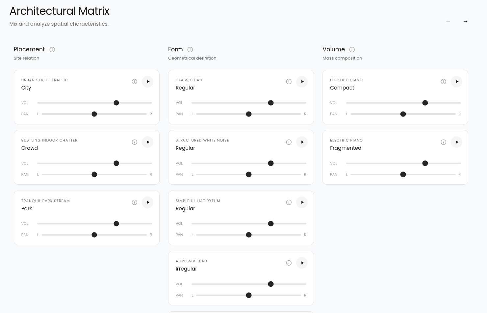

+++
date = '2026-05-21T18:58:24+03:00'
draft = false
title = 'Composing Atmospheres Workshop'

categories = ["Misc"]
tags = ["Architecture", "Electronic Music", "Experimental"]
+++

# About the workshop

I collaborated with my sister, soon-to-be Phd in Architecture, for a workshop that explored the connection between architecture and music.

As I have some previous experience with composing music and I am a CS student, I was tasked with the following:

1) Creating compositions based on students' projects

2) Creating an interactive website where someone can create a composition

# Website

- The website should be up at: https://composingatmospheres.ro/

- The source code for the website should be available here: https://github.com/petru-robu/vibraspace

The app is built in React and has a minimal js backend.

## Mixer
The mixer is part of the website. It is an interactive mixer where someone can select musical elements (grouped by architectural characteristics they may map to) and create a custom composition on the spot in the browser.

## Tools
Here is what I use to achieve this: 
- My DAW of choice is [Cubase](https://www.steinberg.net/cubase/)
- I use a lot of Arturia's [Analog Lab V](https://www.arturia.com/products/software-instruments/analoglab/overview)